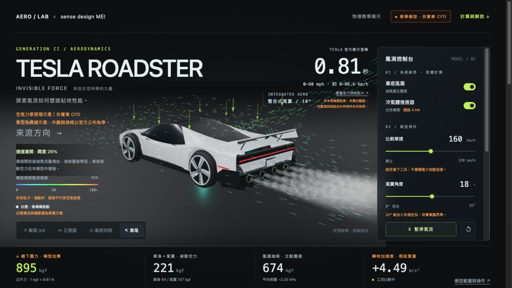

# TESLA ROADSTER

**INVISIBLE FORCE｜來自太空科學的力量**  
AERO / LAB × sense design MEI

以 Roadster 為主題的互動式 3D 空氣力學原理展示。

**[開啟互動展示](https://meimeijazz1206.github.io/roadster-aero-lab/)**

點選上圖即可開啟 3D 互動展示。分享貼文時，直接使用 [展示頁網址](https://meimeijazz1206.github.io/roadster-aero-lab/)，即可直接進入體驗。

- 氣流速度色階、主動式尾翼與車底吸力解說。
- 四個後噴口的白煙、側面導板收合／展開示意。
- 繁體中文介面，可旋轉、縮放並調整參數，支援手機。
- 官方公布的 0–60 mph／0.81 秒展示成績另附原始來源，並非本頁計算結果。

## 展示範圍

車型為模擬示意，外觀與規格以官方公布為準。本專案為獨立物理教學展示，非 Tesla 官方模擬、非實車 CFD。受力採簡化公式與公開假設；流線、白煙及部分機構配置為視覺近似，不能用來預測實車性能。頁面內提供完整假設、公式與來源連結，警語以亮橘色標示。

## 使用

開啟 `index.html`，連網載入 Three.js CDN 即可。互動展示本體為單一 HTML；`preview.jpg` 供專案首頁與社群分享預覽使用。

GitHub Pages 從 `main` 分支的根目錄發布。
